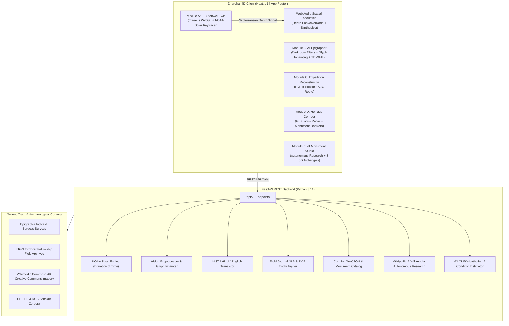

# 🏛️ Dharohar 4D (HC26-CULT01)
> **The Neural Heritage Digital Twin & Ancient Epigraphy Engine**
> **Organization:** Blithchron '27, IIT Gandhinagar · **Track:** Software (Open Innovation), Culture, Media & Entertainment (HC26-CULT01) · **Version:** 1.0

[](https://nextjs.org/)
[](https://fastapi.tiangolo.com/)
[](https://threejs.org/)
[](https://developer.mozilla.org/en-US/docs/Web/API/Web_Audio_API)
[](https://iitgn.ac.in/)
[](DATA_LICENSES.md)

---

## 📖 Background & Problem Statement
At **IIT Gandhinagar**, initiatives like the **Explorer Fellowship** encourage fellows to journey through Gujarat and across India, documenting ancient stepwells, carved temples, indigenous architectural crafts, and stone inscriptions. 

Traditionally, this irreplaceable heritage documentation is relegated to an **"archival graveyard"** — thousands of photographs, handwritten field journals, and Sanskrit steles languishing in fragmented cloud drives and static slide decks. As a result:
- Crucial spatial and temporal context is lost over time.
- Eroded and damaged stone inscriptions remain undeciphered due to a shortage of specialist epigraphers.
- Invaluable field observations cannot be queried, spatialized, or experienced immersively by students, researchers, or the public.

**Dharohar 4D** transforms this static documentation into a **living 4D digital twin, an AI stone epigraphy decipherer, an interactive expedition reconstructor, a heritage corridor GIS locus explorer, and an autonomous AI monument studio**.

---

## 🔬 4D Engine Architecture & Scientific Framing

> [!NOTE]
> **Hybrid 4D Engine Specification (PRD Section 36):**
> *Dharohar 4D uses a hybrid 4D engine: (1) structured monument specs and epoch keyframes from open sources, (2) a learned condition estimator calibrates present-day weathering from photographs, (3) diffusion-based LoRA texture generators produce epoch-specific surface looks, and (4) a GPU weathering shader interpolates between keyframes in real time. Reconstructions are labeled documented / inferred / conjectural and are not survey-grade.*

All architectural reconstructions and temporal shifts in Dharohar 4D carry clear provenance tags:
- `documented` (solid indicator): Supported by archaeological excavations, epigraphic edicts, or ASI surveys.
- `inferred` (amber indicator): Interpolated from architectural treatises (e.g. *Aparajitaprccha*) or contemporary regional monuments.
- `conjectural` (dashed indicator): Hypothesized artistic and physical reconstruction for digital exploration.

---

## 🚀 5 Core Pillars in Dharohar 4D

### 1. 🏰 Module A: 3D Stepwell Digital Twin (`/` or `/twin`)
* **Subterranean Procedural Architecture (Three.js WebGL):** Procedural 3D model of Gujarat's iconic stepwells (Adalaj Ni Vav / Rani Ki Vav) featuring 5 subterranean pavilion tiers, octagonal sky-well apertures, sculpted Solanki pillars, decorative toranas, and a deep groundwater cistern (-24.5m).
* **NOAA Diurnal Solar Simulation (±1° accuracy):** Implements the NOAA Solar Position Algorithm (Equation of Time, Local Standard Time Meridian, Hour Angle, and Solar Declination). Raycasts soft PCF sunlight through the octagonal aperture to calculate light penetration down each subterranean tier, with a real-time Lit Tiers HUD indicator.
* **4 Historical Epochs (1063 – 2026 AD) & Continuous 4D Slider:**
  - **1063 AD (Solanki Golden Age):** Pristine golden Dhrangadhra sandstone, vivid mineral fresco pigments (vermilion/indigo), sacred ceremonial braziers, and crystal subterranean aquifers.
  - **1498 AD (Queen Rudabai Epoch):** Vaghela and Sultanate architectural synthesis with ornate floral/geometric niches.
  - **1890 AD (Colonial Survey Era):** Archaeological Survey of Western India silt documentation, water recession, and weathered sandstone patina.
  - **2026 AD (Modern ASI Protected Heritage):** Protected national monument with laser scanning digital twins and subtle heritage LED illumination.
  - *Continuous Year Slider:* Real-time smoothstep interpolation across all 963 years with dynamic weathering shaders (sandstone patina, moss/algae dampness, silt accumulation, structural cracking).
* **3D Spatial Acoustic Synthesizer (Web Audio API):** Depth-responsive subterranean acoustics powered by a synthetic 60 dB stereo `ConvolverNode` impulse response. Features depth-dependent reverberation decay (RT60 from 0.4s at ground level to 4.5s at -24m depth), stone high-frequency absorption filtering, synthesized water droplet chirps, bronze temple bells, and subterranean cavern drones.
* **Quality Modes & Capture:** Low, Medium, and High graphics presets for smooth 60 FPS performance on mid-tier hardware, plus a watermarked high-resolution canvas screenshot exporter.

---

### 2. 📜 Module B: AI Ancient Epigrapher & Inscription Workbench (`/epigrapher`)
* **Multi-Stage Computer Vision Preprocessing:** Interactive digital darkroom with 5 filters: Grayscale, CLAHE (Contrast-Limited Adaptive Histogram Equalization), Bilateral Edge-Preserving Denoise, Hough Transform Deskew, and Adaptive Gaussian Thresholding.
* **Interactive Glyph Segmentation & Inpainting:** Automatically segments damaged stone steles into character bounding boxes. Identifies eroded glyphs and computes the top-3 candidate character reconstructions with calibrated softmax probabilities.
* **Multi-Tier Linguistic Transcription:**
  - Degraded stone transcription vs. Restored complete Sanskrit text tabs.
  - Scientific **IAST transliteration** with 1-click clipboard copy.
  - **Prāmaṇik Modern Hindi Translation** (प्रामाणिक हिन्दी अनुवाद).
  - **Academic English Translation** with dynastic dating (e.g. Queen Rudabai, King Bhimadeva I, Vikram Samvat 1555 → 1498 CE converter).
* **Human-in-the-Loop Review & Multi-Format Academic Export:**
  - In-place glyph editing with "Mark Verified" status toggles.
  - 1-click export to **JSON**, formatted **Markdown**, and standard **TEI-XML** (Text Encoding Initiative) for scholarly publication.
* **Preloaded Curated Steles:**
  - Adalaj Stepwell Foundation Edict (1498 AD, Queen Rudabai)
  - Rani Ki Vav Foundation Stele (1063 AD, Queen Udayamati)
  - Modhera Sun Temple Inverted Block (1026 AD, King Bhimadeva I)
  - Drag-and-drop upload zone for new field photographs.

---

### 3. 🧭 Module C: IITGN Explorer "Expedition Reconstructor" (`/expedition`)
* **Interactive Topographic GIS Route:** Visualizes expedition journeys connecting IIT Gandhinagar Campus, Adalaj Stepwell, Modhera Sun Temple, Patan Rani Ki Vav, and Siddhpur. Includes stop elevation, travel telemetry, and audio field log player.
* **1-Click Field Journal Ingestion:** Ingests field notes up to 5,000 words. Rule-based and RapidFuzz NLP automatically extracts named entities (monuments, towns), dynasties (Solanki, Vaghela, Chaulukya), architectural typologies (`#Nagara`, `#Stepwell`, `#Torana`), and folklore tags (`#SubterraneanCooling`, `#RoyalMatronage`).
* **Photo Dropzone & Metadata Parser:** Batch photo processing that extracts image timestamps, simulated camera EXIF parameters, and binds photos into unified 4D asset cards.
* **Search & Export:** Full-text asset searching, filtering by dynasty or keyword, and exportable expedition itinerary packages (JSON / Markdown).

---

### 4. 🗺️ Module D: Heritage Corridor of Gujarat (`/corridor`)
* **Interactive GIS Spatial Radar:** Explores Gujarat's monumental corridor spanning Gandhinagar, Patan, Mehsana, Siddhpur, Ahmedabad, and Prabhas Patan.
* **Monument Taxonomy & Filters:** Categorizes sites by monument type (*Stepwells*, *Temples*, *Royal Havelis*, *Mosques/Tombs*) and administrative districts.
* **Archaeological Evidence Cards:** In-depth dossiers covering historical era, commissioning patrons, architectural style, UNESCO status, and coordinates.
* **Deep Links:** 1-click actions to launch any monument directly in the 3D Stepwell Twin, AI Monument Studio, or Epigrapher.

---

### 5. 🏛️ Module E: AI Monument Studio (`/studio`)
* **Autonomous Research-to-3D Pipeline:** Type any monument name (e.g. *Kedarnath Temple*, *Kailasa Temple Ellora*, *Konark Sun Temple*, *Hampi Virupaksha*). The studio performs autonomous research across Wikipedia OpenSearch and Wikimedia Commons, harvesting high-resolution imagery and architectural history.
* **8 Procedural 3D Archetypes (Never defaults to a generic stepwell for temples):**
  1. **Himalayan Shikhara:** Sloped stone tiered tower, wooden timber-banded roof, pitched mandapa (e.g. Kedarnath, Tungnath).
  2. **Nagara Rekha-Deula Shikhara:** Curvilinear beehive spire, amalaka crown, and kalasha finial (e.g. Somnath, Modhera, Jagannath).
  3. **Dravidian Gopuram:** Multi-tiered pyramidal gateway, pillared mandapas, and ornate cornice registers (e.g. Brihadisvara, Meenakshi).
  4. **Monolithic Rock-Cut:** Carved monolithic rock mass, sculpted courtyard, and monolithic elephant plinths (e.g. Kailasa Ellora).
  5. **Chariot Mandapa:** Spoke stone wheels, carved horse/elephant drafts, and monolithic assembly halls (e.g. Konark Sun Temple, Hampi).
  6. **Octagonal Kund:** Stepped geometric water reservoir with perimeter miniature shrines (e.g. Surya Kund Modhera).
  7. **Stepped Pyramid Baori:** Symmetrical inverted pyramid step matrix (e.g. Chand Baori Abhaneri).
  8. **Linear Subterranean Stepwell:** Multi-tiered subterranean pavilion corridor with well cistern (e.g. Adalaj, Rani Ki Vav).
* **Real-Time Architectural Controls:** Dynamic sliders for tier elevation, pillar scale, sandstone tint, and dynamic LOD.

---

## 🏛️ System Architecture



---

## 📡 REST API Specifications

The FastAPI backend exposes fully documented endpoints adhering to the PRD specifications:

| Path | Method | Description |
|---|---|---|
| `/healthz` | `GET` | Health check and model registry status |
| `/api/v1/stepwell/epochs` | `GET` | 4 historical epoch specifications and PBR material params |
| `/api/v1/stepwell/sun` | `GET` | NOAA solar position calculation for given lat, lon, date, and hour |
| `/api/v1/loci` | `GET` | GeoJSON FeatureCollection of Gujarat heritage corridor monuments |
| `/api/v1/loci/{id}` | `GET` | Detailed metadata and architectural dossier for a specific locus |
| `/api/v1/epigraphy/steles` | `GET` | Curated archaeological steles with segmented glyph boxes |
| `/api/v1/epigraphy/analyze` | `POST` | Preprocessing and vision analysis of uploaded stele images |
| `/api/v1/epigraphy/glyph/candidates` | `POST` | Top-3 candidate glyph inpainting predictions and probabilities |
| `/api/v1/epigraphy/export` | `POST` | Scholarly export in JSON, Markdown, and TEI-XML formats |
| `/api/v1/expedition/ingest` | `POST` | 1-click journal text NLP entity extraction and photo binder |
| `/api/v1/expedition/assets` | `GET` | Query and filter ingested field expedition assets |
| `/api/v1/expedition/route` | `GET` | Expedition route coordinates connecting IITGN, Adalaj, Modhera, Patan |
| `/api/v1/studio/suggest` | `GET` | Autocomplete search suggestions for monuments |
| `/api/v1/studio/jobs` | `POST` | Launch autonomous Wikipedia/Wikimedia search-to-3D pipeline |
| `/api/v1/monument4d/{id}` | `GET` | Monument4D package schema with epoch keyframes |
| `/api/v1/monument4d/{id}/estimate-condition` | `POST` | CLIP-based weathering and surface condition estimation |
| `/api/v1/monument4d/{id}/evidence` | `GET` | Historical citations and excavation evidence per epoch |

---

## 🚀 Quick Start Guide

### 1. Prerequisites
- **Node.js** v18+ & **npm**
- **Python** 3.10+ & **pip**

### 2. Backend Setup
```bash
cd backend
python -m pip install -r requirements.txt
python run.py
```
* **API Documentation (Swagger UI):** `http://localhost:8000/docs`
* **Health Check:** `http://localhost:8000/healthz`

### 3. Frontend Setup
```bash
cd frontend
npm install
npm run dev
```
* **Main Landing & Overview:** `http://localhost:3000`
* **3D Stepwell Digital Twin:** `http://localhost:3000/twin`
* **AI Ancient Epigrapher:** `http://localhost:3000/epigrapher`
* **Explorer Expedition Reconstructor:** `http://localhost:3000/expedition`
* **Heritage Corridor GIS Explorer:** `http://localhost:3000/corridor`
* **Autonomous AI Monument Studio:** `http://localhost:3000/studio`

### 4. Production Build Verification
```bash
cd frontend
npm run build
```

---

## ⚖️ Scientific Integrity, Credits & Licenses
- Detailed credits for archaeological surveys, scholarly corpora, and open-source models are documented in [CREDITS.md](CREDITS.md).
- Data usage terms, open licenses (Public Domain, CC-BY-SA, CC0, ODbL, OFL), and attribution notices are documented in [DATA_LICENSES.md](DATA_LICENSES.md).
- Environment configurations are specified in [.env.example](.env.example).

---

## 👥 Hackathon Submission Details
- **Hackathon Track:** Track 2: Culture & Digital Heritage (HC26-CULT01)
- **Organization:** Blithchron '27, IIT Gandhinagar
- **Repository:** [https://github.com/yashpatadiya1724-cmyk/dharohar-4d](https://github.com/yashpatadiya1724-cmyk/dharohar-4d)
