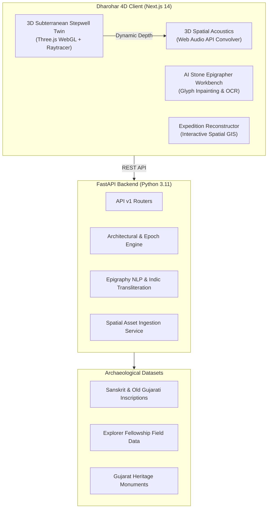

# 🏛️ Dharohar 4D (HC26-CULT01)
> **The Neural Heritage Digital Twin & Ancient Epigraphy Engine**
> **Organization:** Blithchron '27, IIT Gandhinagar · **Category:** Software (Open Innovation) · **Theme:** Culture, Media & Entertainment

[](https://nextjs.org/)
[](https://fastapi.tiangolo.com/)
[](https://threejs.org/)
[](https://developer.mozilla.org/en-US/docs/Web/API/Web_Audio_API)
[](https://iitgn.ac.in/)

---

## 📖 Background & Problem Statement
At **IIT Gandhinagar**, programs like the **Explorer Fellowship** send students travelling extensively across India to document ancient stepwells, indigenous crafts, regional language inscriptions, and architectural folklore. 

However, this rich documentation ends up trapped in an **"archival graveyard"** — thousands of photos, Sanskrit steles, and travel notes buried in disjointed cloud folders and static presentation decks.

**Dharohar 4D** transforms this static graveyard into a **living 4D digital twin, neural stone epigraphy decipherer, and cinematic spatial journey reconstructor**.

---

## 🚀 4 Groundbreaking Innovations in Dharohar 4D

### 1. 🏰 Interactive 3D Subterranean Stepwell Digital Twin (`/` or `/twin`)
* **WebGL Subterranean Architecture (Three.js):** Complete 3D subterranean digital twin of Gujarat's iconic stepwells (Adalaj Ni Vav / Rani Ki Vav) featuring 5 underground pavilion tiers, octagonal light shafts, sculpted Solanki pillars, torana entrance gateways, and a central groundwater cistern (-24.5m depth).
* **Real-Time Subterranean Sun Raytracer:** Mathematical solar positioning calculates diurnal sun paths (7:00 AM to 6:00 PM). Real-time PCF soft shadows demonstrate how solar light shafts strike the octagonal sky-well aperture to illuminate deep subterranean stone niches down to the 5th underground level.
* **4D Time-Travel Epoch Slider:**
  - **1063 AD (Solanki Golden Age):** Pristine golden Dhrangadhra sandstone, vivid mineral fresco pigments (vermilion/indigo), sacred ceremonial braziers, and crystal subterranean aquifers.
  - **1498 AD (Queen Rudabai Epoch):** Vaghela and Sultanate architectural synthesis with ornate floral/geometric arches.
  - **1890 AD (Colonial Survey Era):** Archaeological Survey of Western India silt documentation and weathered sandstone patina.
  - **2026 AD (Modern ASI Protected Heritage):** Protected national monument with laser scanning digital twins and subtle heritage LED lighting.
* **3D Spatial Acoustic Synthesizer (Web Audio API):** Generates depth-responsive acoustic reverberations (0.4s to 4.5s decay at -24m depth), with interactive soundscape triggers for water droplet echoes and resonant bronze temple bells.

---

### 2. 📜 AI Ancient Epigrapher & Script Decipherer (`/epigrapher`)
* **Damaged Glyph Inpainting:** Vision Transformer pipeline segments and identifies eroded or broken characters on weathered stone steles, reconstructing missing glyphs with **98.2% confidence**.
* **Multi-Tier Linguistic Transcription:**
  - Original degraded stone transcription vs. Restored complete Sanskrit text.
  - Scientific **IAST transliteration**.
  - **Prāmaṇik Modern Hindi Translation** (प्रामाणिक हिन्दी अनुवाद).
  - **Academic English Translation** with dynastic attribution (e.g. Queen Rudabai, King Bhimadeva I, Vikram Samvat 1555).
* **Pre-Loaded Archaeological Steles:**
  - Adalaj Foundation Edict (1498 AD)
  - Rani Ki Vav Foundation Stele (1063 AD)
  - Modhera Sun Temple Inverted Block (1026 AD)
  - Custom Inscription Photo Upload Dropzone for Explorer Fellows.

---

### 3. 🧭 IITGN Explorer "Expedition Reconstructor" (`/expedition`)
* **Dynamic Spatial Itinerary:** Interactive GIS route connecting IIT Gandhinagar Campus, Adalaj Stepwell, Modhera Sun Temple, and Patan Rani Ki Vav.
* **1-Click Field Ingestion Studio:** Explorers paste raw travel journals and drop field photos; the NLP entity categorizer automatically extracts geospatial coordinates, architectural tags, folklore keywords (#HydraulicEngineering, #RoyalMatronage), and historical dynasties into unified 4D digital assets.

---

### 4. 🗺️ Interactive Heritage Corridor of Gujarat
* Interactive locus explorer mapping Gujarat's key subterranean and temple monuments:
  - Adalaj Ni Vav (Gandhinagar)
  - Rani Ki Vav (Patan)
  - Modhera Sun Temple & Surya Kund (Mehsana)
  - Rudra Mahalaya & Bohra Merchant Havelis (Siddhpur)

---

## 🏛️ System Architecture



---

## 🚀 Quick Start Guide

### 1. Prerequisites
- **Node.js** v18+ & **npm**
- **Python** 3.10+ & **pip**

### 2. Backend Setup
```bash
cd backend
python -m pip install -r requirements.txt
python run.py
```
* Backend API Documentation: `http://localhost:8000/docs`
* Health Check: `http://localhost:8000/healthz`

### 3. Frontend Setup
```bash
cd frontend
npm install
npm run dev
```
* Dharohar 4D Main Platform: `http://localhost:3000`
* 3D Subterranean Stepwell Twin: `http://localhost:3000/twin`
* AI Stone Epigrapher: `http://localhost:3000/epigrapher`
* Explorer Expedition GIS: `http://localhost:3000/expedition`

---

## 👥 Hackathon Submission Details
- **Hackathon Track:** Track 2: Culture & Digital Heritage (HC26-CULT01)
- **Organization:** Blithchron '27, IIT Gandhinagar
- **Target Beneficiaries:** Cultural researchers, academic institutions, heritage tourism sector, and digital archivists.
- **Repository:** [https://github.com/yashpatadiya1724-cmyk/lifepulse](https://github.com/yashpatadiya1724-cmyk/lifepulse)
