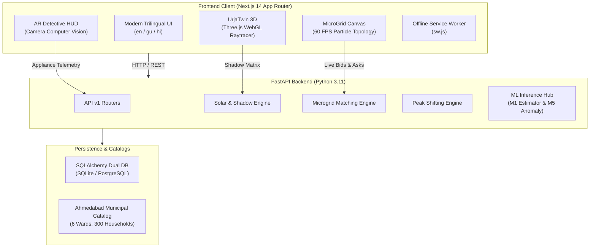

# LiFE Pulse & UrjaTwin 3D (HC26-GEDA01) 🌱⚡
> **Next-Generation Mission LiFE Citizen Engagement App | 3D WebGL Solar Raytracer | AR Energy Detective | P2P Society Microgrid & GEDA Impact Dashboard**

[](https://nextjs.org/)
[](https://fastapi.tiangolo.com/)
[](https://threejs.org/)
[](https://geda.gujarat.gov.in/)

LiFE Pulse is not just another basic CRUD tracker. It is a **groundbreaking, production-grade sustainability engagement ecosystem** designed specifically for Gujarat's energy transition under **GEDA (Problem Statement HC26-GEDA01)**. It bridges the gap between macro climate goals and micro daily habits through **3D WebGL physics, Augmented Reality Computer Vision, and Peer-to-Peer Society Microgrids**.

---

## 🚀 3 Crazy "Never-Seen-Before" Standout Modules

### 1. ☀️ UrjaTwin 3D: WebGL Rooftop Solar Raytracer & Shadow Simulator (`/solar`)
* **3D Building Twin**: Renders residential villas & apartment blocks in high-precision WebGL using Three.js with realistic parapet walls, water overhead tanks, stairwell cabins, and trees.
* **Real-Time Sun Trajectory Engine**: Mathematical solar positioning calculating exact azimuth and elevation angles throughout the day (6:30 AM to 6:30 PM) across Summer, Winter, and Monsoon solstices in Ahmedabad ($23.0225^\circ \text{N}$).
* **PCF Soft Shadow Mapping**: Raytraces dynamic shadow casting from parapets and water tanks in real-time, computing the exact unshaded usable terrace area ($m^2$) and instantaneous solar irradiance ($W/m^2$).
* **1-Click Monocrystalline Array Snapping**: Automatically snaps optimal south-facing $23^\circ$ tilt monocrystalline panels onto unshaded terrace zones and computes instantaneous kW yield and 25-year PM Surya Ghar subsidy breakeven.

### 2. 🔍 AR Appliance Energy Detective: Computer Vision HUD (`/detective`)
* **Live WebCam HUD Scanner**: Turns any smartphone or laptop camera into an Augmented Reality thermal-energy detective reticle.
* **Instant Appliance Detection**: Identifies heavy appliances (Inverter Split ACs, 25L Storage Geysers, Front-Load Washers, Refrigerators, Induction Cooktops, and Standby Electronics).
* **Live Burn Rate & Phantom Leak Ticker**: Computes real-time wattage drain, hourly burn rate in ₹/hr calibrated to Torrent Power / UGVCL peak tariffs (₹7.50/kWh peak vs ₹5.80/kWh off-peak), and grams of $\text{CO}_2$ emitted per minute.
* **1-Click Optimization Ledger**: Instantly commits the recommended eco-tweak (e.g. "Shift geyser to 11 AM solar surplus", "Set AC to 24°C", "Kill standby power") straight into the citizen's daily LiFE ledger.

### 3. ⚡ P2P Society Micro-Grid Energy Trading Hub (`/microgrid`)
* **Interactive 60 FPS Canvas Topology**: Dynamic network graph displaying solar villas, terrace arrays, consumer apartments, community EV chargers, and battery energy storage systems (BESS) along the Satellite 11kV society feeder.
* **Animated Energy Quantum Packets**: Particle flows visually streaming green kilowatt-hours between surplus exporters and power-hungry neighbors.
* **Algorithmic Clearing Price Engine**: Solves the Gujarat solar dilemma where DISCOM feed-in tariffs are only ~₹2.50/kWh while neighbor tariffs are ₹7.50/kWh. The P2P clearing engine settles at **₹5.95/kWh**, saving buyers **21%** on electricity bills and increasing solar owners' earnings by **+138%**!
* **1-Click Peer-to-Peer Order Book**: Submit live buy/sell energy orders, matched instantly with synthetic cryptographic settlement hashes and society green token rewards.

---

## 🌟 Comprehensive Mission LiFE Feature Suite

4. **Under-2-Minute Personalized Baseline Onboarding (`/onboarding`):** Instant calculation of baseline footprint across 6 appliance categories, household members, and transport habits.
5. **Explainable LiFE Score (0–100):** Multi-driver scoring model based on electricity intensity, peak shift adherence, water conservation, and waste segregation.
6. **Smart Peak-Load Shifter (`/peak`):** 24-hour visual load curve helping citizens shift heavy consumption away from Torrent Power's 6 PM – 10 PM grid peak window.
7. **Interactive Ahmedabad Ward Map (`/admin`):** Live SVG interactive map across 6 key Ahmedabad wards (Satellite, Navrangpura, Maninagar, Naranpura, Bopal, Chandkheda) showing real-time participation heatmaps and cumulative MW relief.
8. **Real-Time Smart Meter Telemetry Pulse (`/api/v1/meter`):** 5-second live consumption heartbeat with ML Anomaly Detection flagging sudden phantom energy spikes.
9. **Mission LiFE Water Tracker (`/water`):** Interactive daily water conservation logger and guided 2-Hour Smart Leak Audit Protocol.
10. **Electricity Bill OCR Scanner (`/bill`):** Automatic extraction of consumer number, tariff code, units consumed, and total payable from Torrent Power / UGVCL bills.
11. **WhatsApp Shareable Impact Certificate (`/report`):** One-click downloadable high-resolution citizen sustainability passport with official GEDA verification stamp.
12. **AI Sustainability Coach (`/coach`):** Bilingual RAG-powered guidance engine answering citizen questions and recommending tailored actions.
13. **Trilingual PWA:** Full native support for English, Gujarati (ગુજરાતી), and Hindi (हिन्दी) with offline Service Worker support (`sw.js`).

---

## 🏛️ System Architecture



---

## 🚀 Quick Start Guide

### 1. Prerequisites
- **Node.js** v18+ & **npm**
- **Python** 3.10+ & **pip**

### 2. Backend Setup
```bash
cd backend
python -m pip install -r requirements.txt
python run.py
```
* Backend API Documentation: `http://localhost:8000/docs`
* Health Check: `http://localhost:8000/healthz`

### 3. Frontend Setup
```bash
cd frontend
npm install
npm run dev
```
* Citizen Engagement Platform: `http://localhost:3000`
* 3D Solar Raytracer: `http://localhost:3000/solar`
* AR Energy Detective: `http://localhost:3000/detective`
* Society P2P Microgrid: `http://localhost:3000/microgrid`
* GEDA Administrative Dashboard: `http://localhost:3000/admin`

---

## 🧪 Automated Test Suite
Run the comprehensive backend integration and unit tests:
```bash
cd backend
python tests/run_tests.py
```

---

## 👥 Hackathon Submission Details
- **Hackathon Track:** Track 1: Green Energy & Sustainability (HC26-GEDA01)
- **Organization:** Gujarat Energy Development Agency (GEDA)
- **Target Beneficiaries:** Residential consumers in Gujarat, Co-op Housing Societies, Municipal Wards, and GEDA State Administrators.
- **Repository:** [https://github.com/yashpatadiya1724-cmyk/lifepulse](https://github.com/yashpatadiya1724-cmyk/lifepulse)
